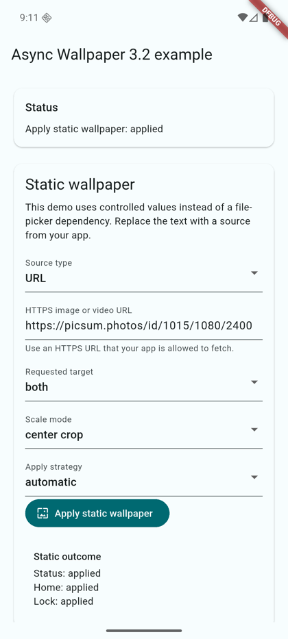
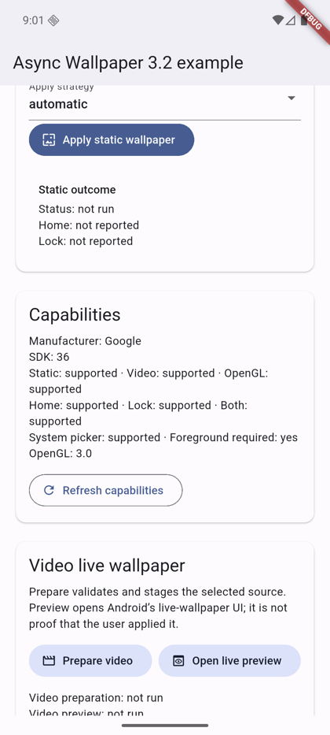
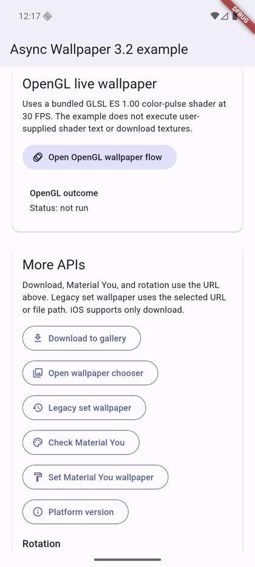
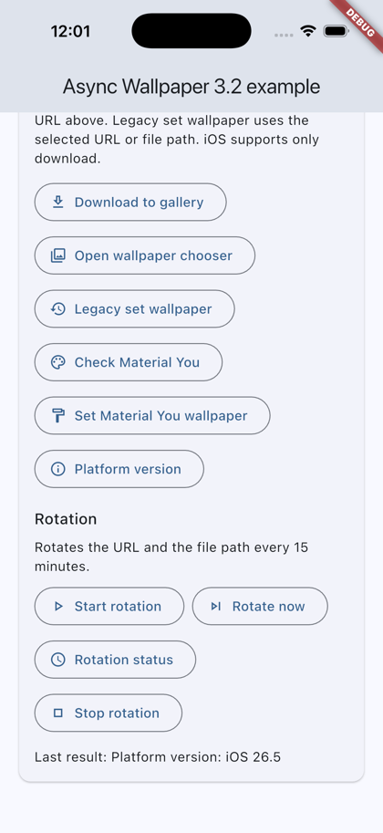
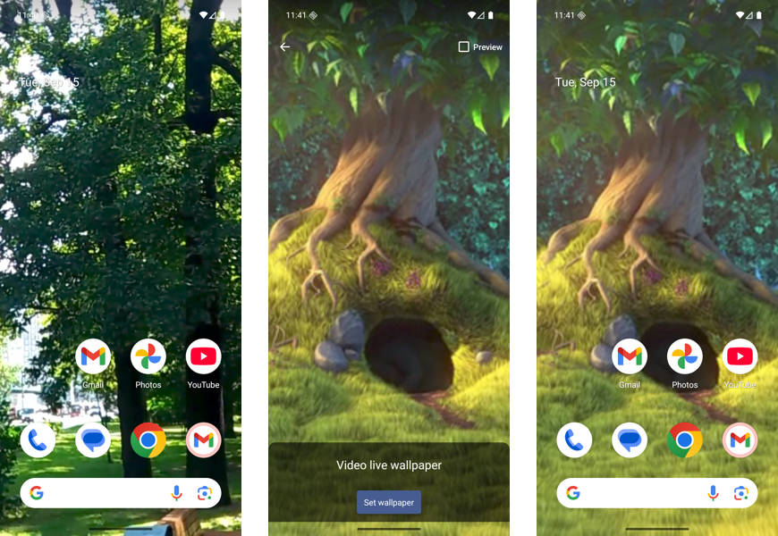
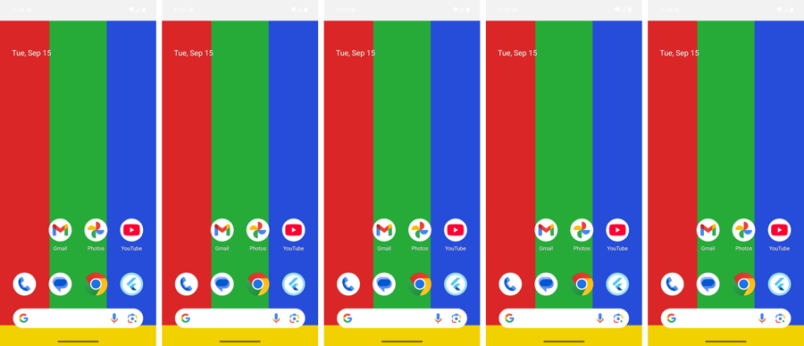

# async_wallpaper

[](https://pub.dev/packages/async_wallpaper)

Flutter plugin to set wallpapers on Android and save them to Photos on iOS.

- Static wallpaper from a URL, file path, content URI, or bytes
- Home, lock, or both targets, with a separate result for each
- Video and OpenGL live wallpapers
- Scheduled wallpaper rotation
- Daily wallpaper schedule (day and night)
- Capability checks before you show an action

## Screenshots

| Static wallpaper | Capabilities | More APIs | iOS |
|---|---|---|---|
|  |  |  |  |

**Video live wallpaper:** home screen before, the system preview, and the applied video.



**Scale modes:** `centerCrop`, `fitCenter`, `center`, `fill`, and `stretch` on a 1080x2400 phone.



## Requirements

- Flutter `>=3.41.4`, Dart `>=3.9.0`
- Android `minSdk 24`
- iOS `13.0+` (download only)

## Installation

```yaml
dependencies:
  async_wallpaper: ^3.7.0
```

```dart
import 'package:async_wallpaper/async_wallpaper.dart';
```

## Usage

### Check capabilities

```dart
final c = await AsyncWallpaper.getCapabilities();
if (c.supportsStaticWallpaper && c.canSetWallpaper) {
  // Show the action.
}
```

### Static wallpaper

```dart
final result = await AsyncWallpaper.applyWallpaper(
  const StaticWallpaperRequest(
    source: WallpaperSource.url('https://example.com/wallpaper.jpg'),
    target: WallpaperTarget.both,
    scaleMode: WallpaperScaleMode.centerCrop,
    strategy: WallpaperApplyStrategy.direct,
  ),
);
if (result.status == WallpaperOperationStatus.applied) {
  // For `both`, read `result.home` and `result.lock`.
}
```

Sources: `WallpaperSource.url` (HTTPS), `filePath`, `contentUri`, `bytes`.

### Video live wallpaper

```dart
final req = VideoWallpaperRequest(
  source: WallpaperSource.filePath('/storage/emulated/0/Download/loop.mp4'),
  target: WallpaperTarget.home,
);
final prepared = await AsyncWallpaper.setVideoWallpaper(req);
if (prepared.status == WallpaperOperationStatus.awaitingUserConfirmation) {
  await AsyncWallpaper.openLiveWallpaperPreview(req);
}
```

`previewOpened` means the system preview opened, not that the user applied it.

### OpenGL live wallpaper

Check `supportsOpenGlLiveWallpaper` first, then call `setOpenGlLiveWallpaper` with a GLSL ES 1.00 fragment shader (1-60 FPS).

The shader can read the optional `u_tilt` uniform (`vec2`, -1 to 1 per axis) to react to how the phone is tilted. It is `(0, 0)` at rest and on devices without a sensor. Check `supportsTilt` first. Declaring it does not fail on 3.5.0, but it stays `(0, 0)` there.

```glsl
precision mediump float;
varying vec2 v_uv;
uniform vec2 u_tilt;
uniform sampler2D u_texture0;

void main() {
  vec2 uv = v_uv + u_tilt * 0.01;
  gl_FragColor = texture2D(u_texture0, uv);
}
```

#### Different content on Home and Lock (Android 16)

On Android 16 (API 36) and later, the OpenGL live wallpaper can show different content on the Home Screen and the Lock Screen. Pass a `contentTag` to label each content set. The user still picks Home, Lock, or both in the system preview, because Android has no public API to set one screen. After the preview closes and the app resumes, call `getLiveWallpaperScreens()` to read what each screen shows. On older Android, all screens share the latest content, and `result.effectiveTarget` is `WallpaperTarget.both`.

```dart
final caps = await AsyncWallpaper.getCapabilities();
if (caps.supportsOpenGlLiveWallpaper && caps.supportsPerScreenLiveWallpaper) {
  final result = await AsyncWallpaper.setOpenGlLiveWallpaper(
    OpenGlLiveWallpaperRequest(
      fragmentShader: shader,
      target: WallpaperTarget.lock,
      contentTag: 'lock:aurora',
    ),
  );
  // On older Android, result.effectiveTarget is WallpaperTarget.both.
}

// After the preview closes and the app resumes:
final screens = await AsyncWallpaper.getLiveWallpaperScreens();
final lockTag = screens.lock.contentTag; // 'lock:aurora' when Lock shows this content.
```

### Wallpaper rotation

```dart
await AsyncWallpaper.startWallpaperRotation(
  const WallpaperRotationRequest(
    sources: <WallpaperRotationSource>[
      WallpaperRotationSource(sourceType: WallpaperSourceType.url, source: 'https://example.com/1.jpg'),
      WallpaperRotationSource(sourceType: WallpaperSourceType.file, source: '/storage/emulated/0/Download/2.jpg'),
    ],
    target: WallpaperTarget.both,
    intervalMinutes: 60,
    order: WallpaperRotationOrder.shuffle,
    triggers: <WallpaperRotationTrigger>{
      WallpaperRotationTrigger.interval,
      WallpaperRotationTrigger.charging,
      WallpaperRotationTrigger.timeOfDay,
    },
    activeHoursStart: 6,
    activeHoursEnd: 23,
  ),
);
await AsyncWallpaper.getWallpaperRotationStatus();
await AsyncWallpaper.rotateWallpaperNow();
await AsyncWallpaper.stopWallpaperRotation();
```

The minimum interval is 15 minutes. URLs must be HTTPS. Rotation uses `WorkManager` and needs no foreground service.

### Daily schedule

Show one wallpaper by day and another by night. Each entry applies from its minute until the next entry's minute, on the local clock.

```dart
await AsyncWallpaper.startDailySchedule(
  const DailyScheduleRequest(
    entries: <DailyScheduleEntry>[
      DailyScheduleEntry(
        minuteOfDay: 7 * 60,
        source: WallpaperRotationSource(
          sourceType: WallpaperSourceType.url,
          source: 'https://example.com/day.jpg',
        ),
      ),
      DailyScheduleEntry(
        minuteOfDay: 19 * 60,
        source: WallpaperRotationSource(
          sourceType: WallpaperSourceType.url,
          source: 'https://example.com/night.jpg',
        ),
      ),
    ],
    target: WallpaperTarget.both,
  ),
);
```

- Android only. iOS and other platforms return `unsupported`.
- Use 2 to 100 entries. Each minute runs from 0 to 1439, and no two entries share a minute.
- Sources are the same HTTPS URLs and file sources that rotation uses. Every source is cached when the schedule starts. If one source fails, the request fails and the running schedule or rotation stays as it was.
- Starting a daily schedule stops rotation. A successful `startWallpaperRotation` stops the daily schedule.
- One inexact alarm drives the next switch. No exact-alarm permission is needed, so Doze can deliver a switch some minutes late. Show a time such as "around 07:00" in your UI.
- Each alarm applies the entry that owns the current local time. Boot, clock changes, time zone changes, and app updates apply the current entry and arm the alarm again. If another wallpaper change is in progress, a durable background job does it later.
- Call `applyCurrentScheduleEntry()` when the app opens. It re-arms an alarm that a force stop removed. If it returns `failed` and the cache is missing, call `startDailySchedule` again.
- If a cached source is missing, `getDailyScheduleStatus()` reports the error immediately. Applying then returns `failed` and cancels the unusable alarm. `nextSwitchEpochMs` is 0 while the cache is incomplete.
- `getDailyScheduleStatus()` returns the mode (`none`, `rotation`, or `dailySchedule`), the entry count, the current and last applied entry index, `nextSwitchEpochMs` (0 when none), and `lastError`.
- `stopDailySchedule()` stops the schedule, cancels the alarm, and deletes the cache.

### Download

```dart
await AsyncWallpaper.downloadWallpaper(
  const DownloadWallpaperRequest(url: 'https://example.com/wallpaper.jpg'),
);
```

- iOS: add `NSPhotoLibraryAddUsageDescription` to `Info.plist`.
- Downloads require HTTPS, a valid image response, and a payload no larger than 64 MiB.
- Android 9 and older: declare `WRITE_EXTERNAL_STORAGE` with `android:maxSdkVersion="28"` and request it before you call `downloadWallpaper`.

## Platform support

| | Android | iOS | Web/desktop |
|---|---|---|---|
| Static, live, OpenGL, rotation, daily schedule | Yes | `unsupported` | `unsupported` |
| Download | Yes | Yes | `unsupported` |

- Background work (for example `WorkManager`): use `WallpaperApplyStrategy.direct`. The cropper, picker, and live previews need a foreground Activity and return `foregroundRequired` otherwise.
- The plugin shows no toasts and does not navigate. Your app shows its own UI from the result.

## Docs

- [Example app](example/README.md)
- [Android compatibility](doc/android-compatibility.md)
- [iOS download tests](doc/ios-download-testing.md)
- [Migration guide](doc/migration.md)
- [Changelog](CHANGELOG.md)

## Contributing

Report bugs with the [bug report template](https://github.com/codenameakshay/async_wallpaper/issues/new?template=bug_report.md) and include the device model, Android version, and steps to reproduce. Request features with the [feature request template](https://github.com/codenameakshay/async_wallpaper/issues/new?template=feature_request.md). Read [CONTRIBUTING.md](CONTRIBUTING.md) before you open a PR.

## License

MIT
